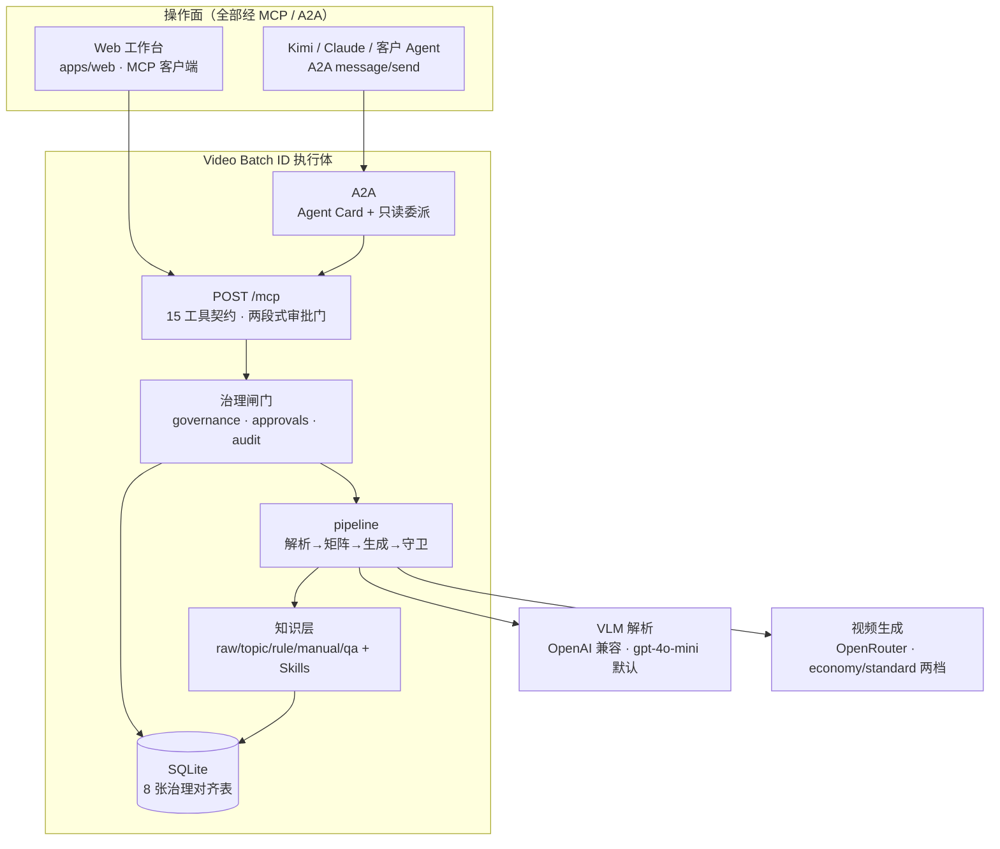

<div align="center">

# Video Batch ID

**让一条好素材，安全地变成一百条好素材。**

<sub>参考素材二创 · 变量矩阵控制 · 保真去重双守卫 · MCP-first AI-Native 执行体</sub>

[](https://github.com/vfvincentwong2026/video-batch-id/actions)
[](#技术栈)
[](#mcp-工具面15-个)
[](#a2a-对接)
[](./LICENSE)

[痛点](#痛点) · [为什么](#为什么) · [核心概念](#核心概念) · [案例](#案例dapur-ibu-的一条爆款如何变成三十条) · [AI-Native 架构](#ai-native-架构) · [MCP 工具面](#mcp-工具面15-个) · [快速开始](#快速开始) · [路线图](#路线图) · [English](#english)

</div>

---

## 痛点

**核心素材的复用率几乎为零。**

一条爆款视频在 TikTok Indonesia / Shopee Video 跑出来后，卖家面临的选择只有两个：

- **直接重发** → 平台判定重复，限流，播放断崖。
- **人工二创** → 剪辑师每条改 30 分钟，一周改不出 20 条，成本比重新拍还高。

用 AI 重新生成？产品外观变了、卖点丢了、印尼本地风格断了，不能用。套通用模板？套不出原来那条的「味道」。

**中间那块能力是空的**：保留核心、可控变化、批量产出、通过平台去重。

Video Batch ID 就是为这块空白而建，专为印尼短视频电商场景设计。

---

## 为什么

生成一条好视频是创意问题；**让一条好视频安全地复制出一百条变体**是工程问题。

Video Batch ID 把一条参考素材拆解成**可独立控制的变量矩阵**，让运营勾选「变什么、不变什么」，批量产出既保留核心、又足够不同的变体，并通过**保真守卫**和**去重守卫**确保每条都能用、都能过审。

**设计原则**

- **参考优先，提示词其次** — 从一条已验证的好素材出发，而不是从空白输入框开始。
- **变量可控，核心锁定** — 每条变体都明确知道「变了什么、没变什么」。
- **双守卫兜底** — 保真守卫确保产品/卖点不变，去重守卫确保平台不判重。
- **素材谱系复利** — 一个 Master 衍生 N 个变体，哪个 Master 最值钱一目了然。
- **MCP-first，AI-Native** — 所有能力先定义为 MCP 工具契约；Web UI 只是 MCP 的一个客户端；每次解析、生成、审核都在沉淀知识与 Skill，未来整体托管进 [ai-native-dam](https://github.com/vfvincentwong2026/ai-native-dam)。
- **印尼本地优先** — 原生支持 Bahasa Indonesia 语境、本地食品材质表现、TikTok ID / Shopee 去重特征。

---

## 核心概念

### 变量矩阵（Variable Matrix）

一条参考视频被 VLM 解析后，拆成六个可独立控制的维度：

| 维度 | 可变 | 必须保持不变 |
|------|------|----------------|
| **视觉** | 场景、光线、色调、构图、背景道具 | 产品外观、关键动作、品牌色 |
| **人物** | 模特身份、服装、表情、手部特征 | 镜头角度、动作节奏 |
| **文案** | 开头 Hook、卖点顺序、CTA、语言风格 | 核心信息、品牌调性 |
| **节奏** | 时长、剪辑密度、转场 | 关键镜头顺序 |
| **音频** | BGM、音效强度、语速、材质音效 | 口播内容（可选锁） |
| **技术** | 分辨率、画幅、字幕样式 | — |

**食品高材质内容特别强化**（糖类、酱料、拉丝、半透明产品）：通透度、表面光泽、拉丝长度、粘性表现可作为视觉子变量独立控制。

运营的操作模型极简：**上传参考 → 勾选变量 → 设变体数量 → 生成**。

### 双守卫（Dual Guard）

- **保真守卫**：CLIP embedding + 颜色/通透度校验，确保变体里产品外观、品牌元素、核心卖点与 Master 一致。
- **去重守卫**：pHash + 关键帧 CLIP 距离 + 音频指纹三重检测，确保变体之间、变体与 Master 之间的相似度低于平台判重阈值。

任一变体未通过守卫，自动标记为「待人工复核」，**不会混入合格队列**。

### 变体谱系（Lineage）与知识复利

素材库不是文件夹，是**谱系树**：

```text
Master: Sambal Matah 爆款 (播放 50万 · 带货 2000单)
├── V01 · 场景=厨房 · 模特=A · Hook=倾倒 → 播放 8万
├── V02 · 场景=餐厅 · 模特=B · Hook=拉丝 → 播放 12万
└── ... 共 30 个变体
```

**哪个 Master 衍生了最多好评变体，它就是最值钱的资产。** 每次解析、生成、审核都会自动写入知识层（raw → topic → rule），跑通的配方可注册为 versioned Skill，驱动下一轮生产决策。

---

## 案例：Dapur Ibu 的一条爆款如何变成三十条

> **背景**：Dapur Ibu 的 **Sambal Matah** 辣椒酱在 TikTok Indonesia 上跑出一条爆款——酱汁倾倒 + 慢动作拉丝 + 试吃反应，播放 **50 万**，带货 **2000 单**。想复用，但直接重发会被限流，人工改又太慢。

### ① 上传 Master Asset → ② 解析

运营把爆款拖进工作台。VLM 自动解析出：4 个镜头共 11 秒、Hook 结构、印尼语文案、120 BPM BGM、快切节奏（平均 2.7 秒/镜头）。

### ③ 勾选变量 → 设变体数

```text
✅ 换场景   厨房台面 → 餐厅 / 户外野餐 / 办公室（3 种）
✅ 换模特   印尼女性 A → B / C（2 种）
✅ 换 Hook  倾倒 → 拉丝 / 试吃 / 开盖（4 种）
🔒 锁定产品 瓶身外观、标签、品牌色
🔒 锁定卖点 "segar"（新鲜）、"pedasnya nampol"（辣得过瘾）
```

组合空间 = 3 × 2 × 4 = **72 种**，采样生成 **30 条**，预估成本 **$4.50**（economy 档更低，$0.12/条起）。

### ④ 批量生成 → 双守卫 → 审核入库

30 条变体逐条过守卫：保真全部通过（一致度 > 0.92）；去重 27 条通过，3 条相似度过高自动拦截。运营网格审核 👍 18 条入库，建立谱系。

### ⑤ 复利

三周后 V02（餐厅 + 模特 B + 拉丝 Hook）成为谱系里最高复用变体。推新品 Sambal Bawang 时，知识层推荐：「V02 的 Hook 结构 + 餐厅场景，在 Sambal 品类下历史好评率 78%，建议复用为 Master 模板。」

| 维度 | 传统二创 | Video Batch ID |
|------|----------|----------------|
| 30 条变体耗时 | 15 小时（剪辑师） | **约 25 分钟** |
| 30 条变体成本 | ≈ $150（人工） | **$4.50（算力，economy 档 $3.60）** |
| 通过平台审核 | 靠经验，常被判重 | **双守卫拦截废片** |
| 下一个 Master | 重新摸索 | **从谱系与 Skill 继承最优配置** |

---

## AI-Native 架构

> **Owner 裁决**：VBID 是**原生态 AI-Native 项目**，未来以 `packages/video-distiller/` 形态**托管融合进 [ai-native-dam](https://github.com/vfvincentwong2026/ai-native-dam)**。因此每一行代码、每一张表、每一个端点都按「即将被 DAM 托管」的标准写。完整方案见 [docs/06](docs/06_AI_native_改造方案.md)，对接验证见 [docs/07](docs/07_A2A_对接验证报告.md)。

**三条铁律**

1. **MCP-first** — 全部能力先定义为 MCP 工具契约（`POST /mcp`，JSON-RPC），SPA、A2A Agent、任何 MCP 客户端共用同一操作面；不留私有端点（REST 仅保留摄入/演示，已标 deprecated）。
2. **治理不自建** — Rights / Approval / Audit 语义照抄 DAM 的 policies 与 shared-schema；本地 SQLite 8 张表（assets / tasks / rights / approvals / audit_log / knowledge_entries / skills / skill_versions）与 DAM Postgres migrations 对齐，平移零改动。
3. **知识与 Skill 从第一天沉淀** — 解析、生成、审核自动写知识层（raw/topic/rule/manual/qa 五层）；跑通的配方过门槛（≥3 任务 / ≥8 变体 / 👍率 ≥60%）注册为 versioned Skill。



### MCP 工具面（15 个）

读写一律经 `POST /mcp`（JSON-RPC，MCP 协议版本 `2024-11-05`）。`gated: true` 的工具走**两段式审批**：首次调用返回 `-32042` + `approval_token`，以相同参数携带 token 二次调用才执行（令牌一次性、10 分钟有效，金额/余量/档位全展示）。

| 工具 | 风险 | 审批 | 作用 |
|------|------|------|------|
| `search_assets` | low | — | 检索素材/变体（关键词、类型、状态） |
| `get_lineage` | low | — | 谱系树：Master + 全部变体 + 审核状态 |
| `parse_master` | low | — | VLM/结构解析 + 关键帧抽取 |
| `suggest_matrix` | low | — | 智能变量推荐 |
| `check_use` | low | — | 渠道/地区/授权检查 |
| `get_analysis` | low | — | 关键内容分析 |
| `create_task` | medium | ✅ | 创建生成任务 |
| `review_variant` | low | — | 审核 👍/👎（沉淀 rule 层知识） |
| `record_usage` | medium | ✅ | 发布用途登记 |
| `write_knowledge` | medium | ✅ | manual/qa 层知识写入 |
| `submit_generation` | **high** | ✅ | 真实生成（cost-incurring，必批，展示金额/条数/余量/档位） |
| `register_skill` | **high** | ✅ | 跑通配方注册为 versioned skill |
| `list_tasks` | low | — | 任务队列列表 |
| `search_knowledge` | low | — | 知识分层检索 |
| `list_skills` | low | — | Skill 资产列表（含版本与 provenance） |

### A2A 对接

- `GET /.well-known/agent.json` — Agent Card（发现契约）
- `POST /a2a/message/send` — 最小委派：帮助查询、任务状态、二创分析提案（**gated 只读**，委派绝不自动执行，零副作用有测试断言）
- `GET /a2a/tasks/:contextId` — 状态迁移历史

### 生成档位

| 档位 | 模型 | 时长 | 分辨率 | 音频 | 单价 |
|------|------|------|--------|------|------|
| `economy` | `google/veo-3.1-lite` | 4s | 720p | 无 | **$0.12/条** |
| `standard` | `alibaba/wan-2.7` | 5s | 720p | 有 | $0.50/条 |

---

## 功能

| 能力 | 对你意味着什么 |
|------|----------------|
| **参考视频解析** | 上传一条爆款，VLM 自动拆出镜头、Hook、文案、节奏、BGM。 |
| **变量矩阵控制** | 六维可独立开关；食品材质（通透、拉丝、光泽）细粒度控制。 |
| **MCP 工具面** | 15 个工具，任何 MCP 客户端（Kimi / Claude Desktop / 客户 Agent）不看我们的 UI 也能完成全链路。 |
| **两段式审批门** | 花钱的操作（生成/建任务/注册 Skill）先展示金额余量、人工确认后执行。 |
| **A2A 委派** | 其他 Agent 可发任务来查询状态、拿二创提案，但绝不能替你点「确认付款」。 |
| **双守卫** | 保真 + 去重，未通过不混入合格队列。 |
| **变体谱系** | 每个 Master 衍生了哪些变体、哪条效果最好，一图看清。 |
| **知识层** | 五层知识自动沉淀 + 检索，Master 价值榜驱动下一轮生产。 |
| **Skill 注册** | 跑通的配方带版本/权限/溯源注册，可复用可审计。 |
| **实时成本预估** | 生成前知道价格，审批窗看到 key 余量。 |

界面截图见 [`docs/screenshots/`](docs/screenshots/)。

---

## 快速开始

**环境要求** — Node.js 20+（`apps/api` 直接运行 `.ts`，依赖原生 TypeScript 类型剥离；SQLite 走 `node:sqlite`）、pnpm 9、ffmpeg / ffprobe（无系统 ffmpeg 时可设 `VBID_FFMPEG` / `VBID_FFPROBE` 指向任意静态二进制）。

```bash
git clone https://github.com/vfvincentwong2026/video-batch-id.git
cd video-batch-id
cp .env.example .env   # 全部可选；不填任何 key 也能以 ffmpeg 结构解析 + mock 生成跑通
pnpm install
pnpm --filter @vbid/api start
```

| 服务 | 地址 |
|------|------|
| Web 工作台（由 API 静态托管 `apps/web`） | http://localhost:8000 |
| MCP 端点 | `POST http://localhost:8000/mcp` |
| Agent Card | http://localhost:8000/.well-known/agent.json |
| 健康检查 | http://localhost:8000/healthz |

**端到端自验**（合成素材，真实 OpenRouter 生成，约 $0.12）：

```bash
node scripts/e2e-synth.cjs     # 摄入→审批→真实生成→产物落盘
pnpm a2a:verify                # A2A 对接 13 项断言
pnpm -r test                   # 全 workspace 测试
```

### 素材视频不进仓库

参考素材（Master Asset）和生成的变体视频**不提交到 Git**。`assets/`、`Master Asset/` 均已在 `.gitignore` 中忽略。

### 首次使用引导

1. 打开工作台 → **scan-dir** 指向素材目录（或拖入参考视频）
2. 等待 VLM 解析 → 查看镜头表、Hook 结构、文案、BGM
3. 变量矩阵页勾选「变什么、锁什么」→ 查看组合空间
4. 建任务 → **审批窗确认金额与档位** → 生成
5. 审核页标记 👍/👎 → 入库；谱系/知识页看复利

---

## 配置

完整示例见 [`.env.example`](.env.example)。

| 变量 | 说明 | 默认值 |
|------|------|--------|
| `VBID_VLM_MODEL` | 参考解析 VLM（OpenAI 兼容协议） | `openai/gpt-4o-mini` |
| `VBID_VLM_API_KEY` | VLM key（不设则回退 ffmpeg 结构解析） | — |
| `VBID_VLM_BASE_URL` | OpenAI 兼容入口 | `https://openrouter.ai/api/v1` |
| `VBID_GEN_API_KEY` | 真实视频生成 key（不设则 submit_generation 不可用） | 回退 VLM key |
| `VBID_FFMPEG` / `VBID_FFPROBE` | 媒体探测二进制路径（无系统 ffmpeg 时） | PATH 探测 |
| `VBID_FIDELITY_THRESHOLD` | 保真守卫阈值 | `0.92` |
| `VBID_DEDUP_THRESHOLD` | 去重守卫相似度阈值 | `0.65` |
| `VBID_ASSET_DIR` | 素材存储目录 | `./assets` |

> **托管后**：治理平面唯一事实源切换为 ai-native-dam（Postgres），本机 SQLite 退役；TLS 与 Bearer 鉴权由 DAM 部署层终结。差距清单见 [docs/07 第四节](docs/07_A2A_对接验证报告.md)。

---

## 目录结构

```text
video-batch-id/
├── apps/
│   ├── api/                 # 执行体：POST /mcp（15 工具）· A2A · REST 摄入/演示 · SQLite 治理层
│   └── web/                 # 运营工作台——纯 MCP 客户端（六页读路径全走 /mcp）
├── packages/
│   ├── shared-schema/       # MCP 工具契约 · 档位定价 · 手写校验器（Zod 版随 DAM 替换）
│   ├── governance/          # 审批门/权限/审计语义（照抄 DAM，退役随托管）
│   ├── reference-parser/    # 参考解析：ffmpeg 结构 / vlm-api 语义 两 provider
│   ├── variable-matrix/     # 六维变量组合与采样
│   ├── pipeline/            # 工作流 A 编排（解析→矩阵→生成→守卫）
│   ├── gen-provider/        # 生成层 provider（mock / openrouter 两档）
│   └── media-probe/         # ffprobe 探测 + 场景切分
├── scripts/                 # a2a-verify · e2e-synth · verify-synth · find-assets
├── docs/                    # PM 研究 · 验收 · 生成层对比 · AI-Native 方案 · A2A 验证
└── pnpm-workspace.yaml
```

### 文档

- [`docs/00_PM_研究结论与立项建议.md`](docs/00_PM_研究结论与立项建议.md)
- [`docs/02_v0.1_交付与验收报告.md`](docs/02_v0.1_交付与验收报告.md)
- [`docs/05_生成层_provider_三路对比.md`](docs/05_生成层_provider_三路对比.md)
- [`docs/06_AI_native_改造方案.md`](docs/06_AI_native_改造方案.md) — 托管融合终态与三条铁律
- [`docs/07_A2A_对接验证报告.md`](docs/07_A2A_对接验证报告.md) — 13/13 验证 + 遗留差距诚实清单

---

## 路线图

| 版本 | 里程碑 | 状态 |
|------|--------|------|
| v0.1 | 参考解析 · 变量矩阵 · 基础生成 | ✅ |
| v0.5 | MCP 工具面 · 治理闸门 · 知识层 | ✅ |
| **AI-Native 改造（P0-P4）** | 契约对齐 DAM · SPA 切 MCP 客户端 · 学习闭环（Skill 门槛）· Agent Card + A2A 委派 · 端到端真实生成验证 | ✅ 2026-11-12 |
| **托管融合** | 以 `packages/video-distiller/` 并入 [ai-native-dam](https://github.com/vfvincentwong2026/ai-native-dam)，SQLite → DAM Postgres，治理退役本地版 | 下一步 |
| 表现回流 | record_usage 已就位，接 RedFox/OneAPI 投放数据连接器 → rule 层自动回流 | 规划中 |
| 多执行体 | 节奏/音频变量分层生成 · 从零生成工作流 B · 品类模板库 | 规划中 |

---

## 模型许可证

商用需逐模型核对。当前锚点：

| 模型 | 许可证 | 商用说明 |
|------|--------|----------|
| Wan 2.x（经 OpenRouter 路由） | Apache 2.0 | 无收入门槛、无地区排除。 |
| Veo 3.1 Lite（economy 档，经 OpenRouter 路由） | 随 Google 条款 | 按 OpenRouter 商用条款执行。 |
| gpt-4o-mini（VLM 解析） | 随 OpenAI 条款 | 按 OpenRouter 商用条款执行。 |

第三方依赖与模型的许可证以其各自官方条款为准，分发或商用前必须逐项核对。

## 贡献

欢迎提 Issue 和 Pull Request。

## 许可证

本项目代码以 [MIT License](./LICENSE) 开源。第三方依赖、模型权重与素材的许可证以其各自条款为准，不随本项目的 MIT 授权一并授予。

---

<details>
<summary><b>📖 English</b></summary>

## English

### Video Batch ID

**Turn one proven video into a hundred usable variants — safely, controllably, at scale.**

Focused on the Indonesian short-video e-commerce market (TikTok Indonesia, Shopee Video, local food & FMCG brands). **AI-Native by design**: every capability is exposed as an MCP tool contract (`POST /mcp`, 15 tools), the web UI is just one MCP client, governance (two-call approval for cost-incurring actions) mirrors the [ai-native-dam](https://github.com/vfvincentwong2026/ai-native-dam) contracts, and every parse/generate/review writes to a five-layer knowledge base — preparing the project to be hosted as a `video-distiller` capability package inside DAM.

### Core Concepts

- **Variable Matrix** — six controllable dimensions (visual incl. food material properties, person, copy, rhythm, audio, technical). Lock the core, vary the rest.
- **Dual Guard** — Fidelity Guard (CLIP + color/translucency) and Dedup Guard (pHash + CLIP distance + audio fingerprint).
- **Lineage & Knowledge** — every variant traces back to its Master Asset; parsing, generation and review automatically distill into raw/topic/rule knowledge layers, and proven recipes graduate into versioned Skills (≥3 tasks / ≥8 variants / ≥60% 👍).
- **MCP-first** — 15 tool contracts; gated tools (create_task, submit_generation, register_skill, …) require a two-call approval flow (`-32042` + `approval_token`) that always shows cost, tier and key balance before execution.

### Endpoints

| | |
|---|---|
| Web workbench | http://localhost:8000 |
| MCP | `POST /mcp` (JSON-RPC, 15 tools) |
| Agent Card | `GET /.well-known/agent.json` |
| A2A | `POST /a2a/message/send` (read-only delegation, never auto-approves) |
| Health | `/healthz` |

### Quick Start

```bash
git clone https://github.com/vfvincentwong2026/video-batch-id.git
cd video-batch-id
cp .env.example .env          # all keys optional; ffmpeg-struct parse + mock gen works without any
pnpm install
pnpm --filter @vbid/api start # http://localhost:8000
node scripts/e2e-synth.cjs    # end-to-end self-check (synthetic asset, real OpenRouter gen, ~$0.12)
```

**Media files are not committed.** Master Assets and generated variants stay out of Git in the git-ignored `assets/` and `Master Asset/` directories.

### Generation Tiers

| Tier | Model | Duration | Audio | Cost |
|------|-------|----------|-------|------|
| `economy` | `google/veo-3.1-lite` | 4s 720p | no | **$0.12/variant** |
| `standard` | `alibaba/wan-2.7` | 5s 720p | yes | $0.50/variant |

### License

Code is released under the [MIT License](./LICENSE). Third-party dependencies, model weights and media keep their own licenses.

</details>
